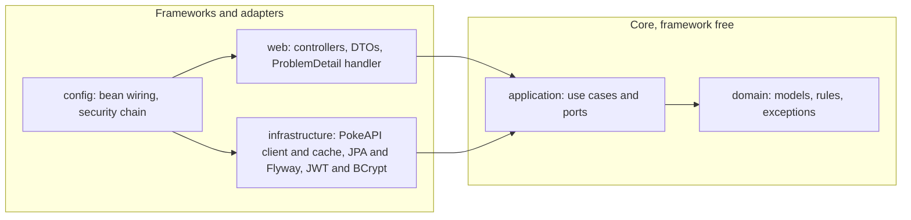

# PokeApp

A full-stack app that browses [PokeAPI](https://pokeapi.co/docs/v2), copies Pokemon into a local MySQL database and lets users add their own fields to them (localized name, region, tags).

- **Backend:** Java 21, Spring Boot 3.5, Gradle, MySQL 8 with Flyway, Spring Security with JWT, and Caffeine caching. Built with Clean Architecture and TDD.
- **Frontend:** React 19, TypeScript, MUI 7, TanStack Query, React Router, react-hook-form with zod.
- **Runtime:** Docker Compose runs MySQL, the backend and the frontend (nginx).

## Quick start (Docker)

```bash
docker compose up --build
```

| Service | URL |
|---------|-----|
| Frontend | http://localhost:3000 |
| Backend API | http://localhost:8080/api/v1 |
| Swagger UI | http://localhost:8080/swagger-ui.html |
| MySQL | `localhost:3307`, database / user / password: `pokeapp` / `pokeapp` / `pokeapp` |

Demo credentials (seeded by Flyway):

| User | Password | Role |
|------|----------|------|
| `ash` | `pikachu123` | USER: browse, sync, list, view and update local Pokemon |
| `admin` | `admin123` | ADMIN: everything a USER can do, plus manual create, delete and bulk "Sync Pokemon data" |

The database is seeded with 10 Pokemon that already have custom fields, so the collection page works without calling PokeAPI.

To use a different host port for MySQL, set `MYSQL_HOST_PORT=3306 docker compose up` (the default is 3307 to avoid clashing with a local MySQL). Override `POKEAPP_JWT_SECRET` (at least 32 bytes) outside of demos.

### Configuration

Every backend environment variable starts with `POKEAPP_`, so it can't collide with generic variables such as `DB_USERNAME` that other projects export in your shell.

| Variable | Default |
|----------|---------|
| `POKEAPP_DB_URL` | `jdbc:mysql://localhost:3307/pokeapp` |
| `POKEAPP_DB_USERNAME` / `POKEAPP_DB_PASSWORD` | `pokeapp` / `pokeapp` |
| `POKEAPP_JWT_SECRET` | development-only secret (at least 32 bytes) |
| `POKEAPP_JWT_TTL` | `2h` |
| `POKEAPP_CORS_ALLOWED_ORIGINS` | `http://localhost:5173,http://localhost:3000` |
| `POKEAPP_POKEAPI_BASE_URL` | `https://pokeapi.co/api/v2` |

### Troubleshooting

- **`Access denied for user 'root'@...` on `./gradlew bootRun`.** The datasource credentials are being overridden. Run `env | grep POKEAPP_` and unset any stale `POKEAPP_DB_*` value. Also check that the `mysql` service is running (`docker compose up -d mysql`); it listens on port 3307.
- **`SPRING_PROFILES_ACTIVE` exported in your shell** (for example `dev`) is harmless: the app has no profile-specific configuration.

## Local development

Requirements: JDK 17+ to run Gradle (Gradle downloads JDK 21 through the foojay toolchain resolver), Node 20+, and Docker (for MySQL and Testcontainers).

```bash
docker compose up -d mysql          # MySQL on localhost:3307
./gradlew bootRun                   # backend on :8080
cd frontend && npm install && npm run dev   # frontend on :5173, proxies /api to :8080
```

### Tests and quality gates

```bash
./gradlew check        # unit, slice, Testcontainers and end-to-end tests, ArchUnit, Spotless, JaCoCo (80% line minimum)
./gradlew spotlessApply

cd frontend
npm test               # Vitest + React Testing Library + MSW
npm run coverage
npm run lint && npm run format:check && npm run build
```

Current results: the backend has 159 tests with 98% line coverage, and the frontend has 36 tests with 98% statement coverage. Frontend tests fail if anything is logged to `console.warn` or `console.error`, which enforces the "no browser console warnings" goal.

## User stories

| Story | Backend | Frontend |
|-------|---------|----------|
| **US01** Paginated list with sprite, category, mass and abilities | `GET /api/v1/pokemon?page&size` | Pokedex grid with pagination and page-size selector; signed-in users see an "In collection" badge on Pokemon already stored locally |
| **US02** Image, stats, description and evolution chain | `GET /api/v1/pokemon/{idOrName}` | Detail page with stat bars and clickable evolution chain |
| **US03** Copy into a local relational store with custom fields | `POST /api/v1/local-pokemon/sync/{idOrName}` (one Pokemon); `POST /api/v1/admin/sync-jobs` (on-demand bulk sync of an id range, ADMIN) | "Add to my collection" button; admin-only "Sync Pokemon data" button on the collection page with live progress and a summary |
| **US04** Update local data with validation | `PUT /api/v1/local-pokemon/{id}`: 400 for an invalid payload, 404 for a missing record, 409 for a stale version | Edit dialog with client-side validation and server errors shown next to each field |

### API

| Method | Path | Access | Notes |
|--------|------|--------|-------|
| POST | `/api/v1/auth/register` | public | 201, 400, or 409 if the username is taken |
| POST | `/api/v1/auth/login` | public | returns a Bearer JWT; 401 if the credentials are invalid |
| GET | `/api/v1/pokemon` | public | US01; cached; 503 if PokeAPI is down |
| GET | `/api/v1/pokemon/{idOrName}` | public | US02; 404 if not found |
| GET | `/api/v1/local-pokemon?page&size&name` | USER | paginated; searches name and local name |
| GET | `/api/v1/local-pokemon/stored-ids?pokeApiIds=1,4,25` | USER | which of the given PokeAPI ids (1-100) are stored locally; drives the "In collection" badge |
| GET | `/api/v1/local-pokemon/{id}` | USER | 404 if not found |
| POST | `/api/v1/local-pokemon/sync/{idOrName}` | USER | US03; 201 with `Location`; 409 if already synced |
| PUT | `/api/v1/local-pokemon/{id}` | USER | US04; the body includes `version` for optimistic locking |
| POST | `/api/v1/local-pokemon` | ADMIN | creates a custom Pokemon manually |
| DELETE | `/api/v1/local-pokemon/{id}` | ADMIN | 204, or 404 if not found |
| POST | `/api/v1/admin/sync-jobs` | ADMIN | US03 bulk sync; optional body `{"fromId":1,"toId":151}` (default 1-151, ids up to 1025, at most 500 per job); 202 with `Location`; 409 if a job is already running |
| GET | `/api/v1/admin/sync-jobs/{id}` | ADMIN | job progress: `status`, `processed`/`total`, `inserted`, `updated`, `failed`, `errors` |
| GET | `/api/v1/admin/sync-jobs/latest` | ADMIN | most recent job, or 204 if none has run since startup |

#### Bulk synchronization

The admin "Sync Pokemon data" button starts a background job on virtual threads. For each PokeAPI id in the range, it inserts the Pokemon if it isn't stored yet. Otherwise it refreshes the catalog fields (name, category, height, weight, sprite, description, types and abilities) and keeps the proprietary ones (`localName`, `region`, `tags`). If an id fails, the job records the error and moves on to the next id. If a user edits a Pokemon at the same moment the job updates it (optimistic-lock conflict), the job re-reads the row and retries once. Only one job runs at a time. Job progress is kept in memory, so it is lost on restart; that is acceptable for a single-node deployment.

Every error is an RFC 7807 `application/problem+json` response. Validation errors include an `errors` map from field name to message.

## Architecture

The backend is a single Gradle module. Its packages follow Clean Architecture (ports and adapters), and the dependency rule is enforced by [ArchUnit tests](src/test/java/org/ballastlane/pokeapp/architecture/ArchitectureTest.java).



| Package | Responsibility |
|---------|----------------|
| `domain` | Immutable records (`LocalPokemon`, `PokemonAttributes`, `PokemonDetail`, `User`, ...), business rules (field limits, tag normalization, password policy, identifier format), and domain exceptions. |
| `application.port.in` | One interface per use case: `BrowsePokemonUseCase`, `GetPokemonDetailUseCase`, `SyncPokemonUseCase`, `BulkSyncPokemonUseCase`, `ManageLocalPokemonUseCase`, `RegisterUserUseCase`, `AuthenticateUserUseCase`. |
| `application.port.out` | Interfaces the core needs from the outside: `PokemonCatalogPort`, `LocalPokemonRepositoryPort`, `SyncJobStorePort`, `UserRepositoryPort`, `PasswordHasherPort`, `TokenIssuerPort`. |
| `application.service` | Use case implementations as plain Java classes with no Spring annotations, created as beans in `config.UseCaseConfig`. |
| `infrastructure.pokeapi` | `RestClient` adapter. It loads each page's entries in parallel on virtual threads, with a concurrency limit, and caches every response in Caffeine (`@Cacheable`; 404s are not cached). |
| `infrastructure.persistence` | JPA entities, Spring Data repositories and adapters. The adapters handle optimistic locking (`@Version`) and turn unique-constraint violations into domain conflicts. |
| `infrastructure.sync` | In-memory store for bulk sync job snapshots. It keeps the 20 most recent jobs. |
| `infrastructure.security` | HS256 JWT issuing and verification, the BCrypt hasher, the JWT filter, and 401/403 responses as ProblemDetail. |
| `web` | REST controllers, request/response records with Bean Validation, mappers, and `GlobalExceptionHandler`. |

Key design decisions:

- **Validation in two layers.** Bean Validation on web DTOs catches malformed input. Domain constructors enforce the business rules, so data is validated even when it doesn't arrive through HTTP.
- **Optimistic locking.** Clients send `version` with each update. Both the service and the adapter reject stale versions with 409, which prevents lost updates.
- **Caching.** Caffeine caches PokeAPI responses on the server (6 h TTL, 5000 entries). Catalog responses also send `Cache-Control: max-age=300` for the browser.
- **Database.** Flyway manages the schema and Hibernate only validates it (`ddl-auto=validate`). The schema has a `users` table, a `pokemon` table (unique `pokeapi_id`, custom fields, `version`, audit timestamps), and ordered child tables for types, abilities and tags.

### Frontend structure

```
frontend/src
  features/auth          AuthProvider (context), login/register forms, ProtectedRoute
  features/catalog       US01 grid, US02 detail page, sync mutation
  features/collection    local CRUD: list/search, edit/create dialog, delete confirmation
  features/sync          admin bulk sync: start dialog, job polling, progress and summary
  shared/api             axios client (JWT interceptor, 401 handling), types, query keys, ProblemDetail helpers
  shared/components      layout, type chips, loading and error states
  test                   MSW server, fixtures, renderApp helper
```

TanStack Query holds all server state and invalidates the collection after each mutation. The only global client state is the auth session in a React context. Page and size live in the URL query string, so pagination links can be shared.

## Development guidelines (Cursor skills)

The project ships three Cursor skills that were written first and followed during implementation:

- [.cursor/skills/clean-architecture/SKILL.md](.cursor/skills/clean-architecture/SKILL.md): the layer map, the dependency rule, ports, mapping at each boundary, and the ArchUnit rules.
- [.cursor/skills/tdd-testing/SKILL.md](.cursor/skills/tdd-testing/SKILL.md): the red-green-refactor loop, which test type to use in each layer, naming, and coverage gates.
- [.cursor/skills/code-quality/SKILL.md](.cursor/skills/code-quality/SKILL.md): Java and React conventions, error handling, and a review checklist.

## Generative AI exercise

See [docs/GENAI.md](docs/GENAI.md).
