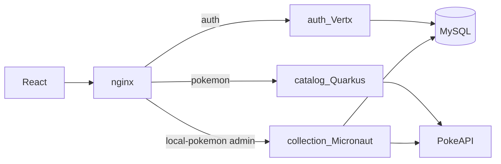

# PokeApp (polyglot)

A full-stack app that browses [PokeAPI](https://pokeapi.co/docs/v2), copies Pokemon into a local MySQL database and lets users add their own fields (localized name, region, tags).

The backend is a **polyglot POC** (no Spring Boot at runtime): three services behind one nginx gateway, chosen so you can compare stacks for interviews and POCs.

| Service | Stack | Port | Responsibility |
|---------|-------|------|----------------|
| `auth` | **Vert.x** | 8081 | Register / login, HS256 JWT |
| `catalog` | **Quarkus** + Vert.x WebClient | 8082 | Public PokeAPI browse / detail |
| `collection` | **Micronaut** | 8083 | Local CRUD, sync, admin Restock jobs + Flyway |
| `frontend` | React 19, TypeScript, MUI 7 | 3000 | UI + API gateway (nginx) |

The Spring Boot monolith is preserved as git tag `spring-monolith` for comparison.

Interview notes: [docs/POLYGLOT.md](docs/POLYGLOT.md). JWT contract: [shared/jwt-contract.md](shared/jwt-contract.md).

## Quick start (Docker)

```bash
docker compose up --build
```

| Service | URL |
|---------|-----|
| Frontend | http://localhost:3000 |
| Auth API | http://localhost:8081/api/v1/auth |
| Catalog API | http://localhost:8082/api/v1/pokemon |
| Collection API | http://localhost:8083/api/v1/local-pokemon |
| Catalog Swagger | http://localhost:8082/swagger-ui |
| MySQL | `localhost:3307`, database / user / password: `pokeapp` / `pokeapp` / `pokeapp` |

Demo credentials (seeded by collection Flyway):

| User | Password | Role |
|------|----------|------|
| `ash` | `pikachu123` | USER |
| `admin` | `admin123` | ADMIN |

Override `POKEAPP_JWT_SECRET` (at least 32 bytes) outside demos. All three backends must share the same secret.

### Configuration

| Variable | Default |
|----------|---------|
| `POKEAPP_DB_URL` | `jdbc:mysql://localhost:3307/pokeapp` |
| `POKEAPP_DB_USERNAME` / `POKEAPP_DB_PASSWORD` | `pokeapp` / `pokeapp` |
| `POKEAPP_JWT_SECRET` | development-only secret (≥ 32 bytes) |
| `POKEAPP_JWT_TTL` | `2h` (auth issuer) |
| `POKEAPP_CORS_ALLOWED_ORIGINS` | `http://localhost:5173,http://localhost:3000` |
| `POKEAPP_POKEAPI_BASE_URL` | `https://pokeapi.co/api/v2` |

## Local development

Requirements: JDK 21+, Node 20+, Docker (MySQL + Testcontainers).

```bash
docker compose up -d mysql collection   # schema + seed on :3307 / collection :8083
cd services/auth-vertx && ./gradlew run          # :8081
cd services/catalog-quarkus && ./gradlew quarkusDev   # :8082
# collection already running, or: cd services/collection-micronaut && ./gradlew run
cd frontend && npm install && npm run dev        # :5173, proxies by path to 8081/8082/8083
```

### Tests

```bash
cd services/auth-vertx && ./gradlew test
cd services/catalog-quarkus && ./gradlew test
cd services/collection-micronaut && ./gradlew test   # needs Docker

cd frontend && npm test && npm run lint && npm run build
```

## User stories (unchanged API)

| Story | Backend | Frontend |
|-------|---------|----------|
| **US01** Paginated list | `GET /api/v1/pokemon` (Quarkus) | Pokedex grid |
| **US02** Detail + evolution | `GET /api/v1/pokemon/{idOrName}` (Quarkus) | Detail page |
| **US03** Sync local + Restock | Micronaut sync + `/admin/sync-jobs` | Collection + Restock Collection |
| **US04** Update with validation | `PUT /api/v1/local-pokemon/{id}` (Micronaut) | Edit dialog |

Auth: `POST /api/v1/auth/register`, `POST /api/v1/auth/login` (Vert.x).

Every error is RFC 7807 `application/problem+json`.

## Architecture



Each service keeps Clean Architecture packages (`domain` / `application` / adapters). Collection owns Flyway for the full schema; auth only reads/writes `users`.

## Generative AI exercise

See [docs/GENAI.md](docs/GENAI.md) (written against the former Spring monolith; use tag `spring-monolith` if you replay it).
