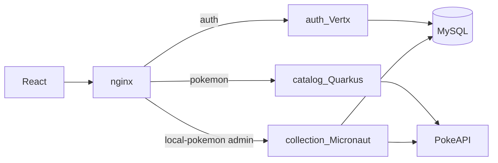

# PokeApp (polyglot)

A full-stack app that browses [PokeAPI](https://pokeapi.co/docs/v2), copies Pokemon into a local MySQL database and lets users add their own fields (localized name, region, tags).

The backend is a **polyglot POC** (no Spring Boot at runtime): three services behind one nginx gateway, chosen so you can compare stacks for interviews and POCs.

| Service | Stack | Port | Responsibility |
|---------|-------|------|----------------|
| `auth` | **Vert.x** | 8081 | Register / login, HS256 JWT |
| `catalog` | **Quarkus** + Vert.x WebClient | 8082 | Public PokeAPI browse / detail |
| `collection` | **Micronaut** | 8083 | Local CRUD, sync, admin Restock jobs + Flyway |
| `frontend` | React 19, TypeScript, MUI 7 | 3000 | UI + API gateway (nginx) |

The Spring Boot monolith is preserved as git tag `spring-monolith` for comparison.

Interview notes: [docs/POLYGLOT.md](docs/POLYGLOT.md). JWT contract: [shared/jwt-contract.md](shared/jwt-contract.md).

## Quick start (Docker)

```bash
docker compose up --build
```

| Service | URL |
|---------|-----|
| Frontend | http://localhost:3000 |
| Auth API | http://localhost:8081/api/v1/auth |
| Catalog API | http://localhost:8082/api/v1/pokemon |
| Collection API | http://localhost:8083/api/v1/local-pokemon |
| Catalog Swagger | http://localhost:8082/swagger-ui |
| MySQL | `localhost:3307`, database / user / password: `pokeapp` / `pokeapp` / `pokeapp` |

Demo credentials (seeded by collection Flyway):

| User | Password | Role |
|------|----------|------|
| `ash` | `pikachu123` | USER |
| `admin` | `admin123` | ADMIN |

Override `POKEAPP_JWT_SECRET` (at least 32 bytes) outside demos. All three backends must share the same secret.

### Configuration

| Variable | Default |
|----------|---------|
| `POKEAPP_DB_URL` | `jdbc:mysql://localhost:3307/pokeapp` |
| `POKEAPP_DB_USERNAME` / `POKEAPP_DB_PASSWORD` | `pokeapp` / `pokeapp` |
| `POKEAPP_JWT_SECRET` | development-only secret (≥ 32 bytes) |
| `POKEAPP_JWT_TTL` | `2h` (auth issuer) |
| `POKEAPP_CORS_ALLOWED_ORIGINS` | `http://localhost:5173,http://localhost:3000` |
| `POKEAPP_POKEAPI_BASE_URL` | `https://pokeapi.co/api/v2` |

## Local development

Requirements: JDK 21+, Node 20+, Docker (MySQL + Testcontainers).

```bash
docker compose up -d mysql collection   # schema + seed on :3307 / collection :8083
cd services/auth-vertx && ./gradlew run          # :8081
cd services/catalog-quarkus && ./gradlew quarkusDev   # :8082
# collection already running, or: cd services/collection-micronaut && ./gradlew run
cd frontend && npm install && npm run dev        # :5173, proxies by path to 8081/8082/8083
```

### Tests

```bash
cd services/auth-vertx && ./gradlew test
cd services/catalog-quarkus && ./gradlew test
cd services/collection-micronaut && ./gradlew test   # needs Docker

cd frontend && npm test && npm run lint && npm run build
```

## User stories (unchanged API)

| Story | Backend | Frontend |
|-------|---------|----------|
| **US01** Paginated list | `GET /api/v1/pokemon` (Quarkus) | Pokedex grid |
| **US02** Detail + evolution | `GET /api/v1/pokemon/{idOrName}` (Quarkus) | Detail page |
| **US03** Sync local + Restock | Micronaut sync + `/admin/sync-jobs` | Collection + Restock Collection |
| **US04** Update with validation | `PUT /api/v1/local-pokemon/{id}` (Micronaut) | Edit dialog |

Auth: `POST /api/v1/auth/register`, `POST /api/v1/auth/login` (Vert.x).

Every error is RFC 7807 `application/problem+json`.

## Architecture



Each service keeps Clean Architecture packages (`domain` / `application` / adapters). Collection owns Flyway for the full schema; auth only reads/writes `users`.

## Project structure

```
pokeapp/
├── docker-compose.yml            # MySQL + the three backends + the frontend gateway
├── services/
│   ├── auth-vertx/               # Vert.x: register, login, HS256 JWT
│   ├── catalog-quarkus/          # Quarkus: public PokeAPI browse and detail
│   └── collection-micronaut/     # Micronaut: local CRUD, sync, schema owner
├── frontend/                     # React UI; nginx routes /api to the three services
├── shared/                       # Contracts every backend must keep
├── docs/                         # Interview notes and the GenAI exercise
└── documentation/                # Plan that produced this polyglot layout
```

### `services/`

Three independent Gradle projects (Java 21). Each one is a Clean Architecture module: frameworks stay in the outer packages, and `domain` / `application` depend only on the JDK.

| Package | What it holds |
|---------|----------------|
| `domain` | Models, validation rules, and domain exceptions. |
| `application` | Use cases and ports (`port.in` / `port.out`). |
| `infrastructure` | Driven adapters: MySQL, PokeAPI, password hashing, JWT checks, persistence. |
| `web` | Driving adapters: HTTP handlers, request/response DTOs, RFC 7807 errors. |
| `config` | Wiring and properties (catalog and collection). Auth wires itself inside its Vert.x verticle. |

What is specific to each service:

- **`auth-vertx/`** — Vert.x Web on port 8081. Register and login against the `users` table, BCrypt passwords, and HS256 tokens. It does not run Flyway.
- **`catalog-quarkus/`** — Quarkus on port 8082. Public list and detail from PokeAPI through a Vert.x WebClient, with a Caffeine cache. No database. Swagger is at `/swagger-ui`.
- **`collection-micronaut/`** — Micronaut on port 8083. Local Pokemon CRUD, single sync, and admin Restock jobs. `src/main/resources/db/migration/` is the Flyway owner of the shared schema (`users`, pokemon tables, and the `ash` / `admin` seed). It validates the JWT issued by auth.

`src/test` in each service mirrors the production packages (unit tests, plus Quarkus tests and a Micronaut Testcontainers smoke test).

### `frontend/`

React 19, TypeScript, and MUI. In Docker, `nginx.conf` is the API gateway on port 3000. `vite.config.ts` is the same split in local dev: `/api/v1/auth` to 8081, `/api/v1/pokemon` to 8082, and local-pokemon plus admin routes to 8083.

| Path | What it holds |
|------|----------------|
| `src/features/auth/` | Login, register, token storage, and route guards. |
| `src/features/catalog/` | Pokedex grid, detail page, stats, and evolution chain. |
| `src/features/collection/` | Local collection list, edit dialog, and delete. |
| `src/features/sync/` | Sync-one and the admin Restock Collection flow. |
| `src/shared/` | App shell, theme, and the Axios client that sends the Bearer token and reads problem+json errors. |

### `shared/`

Markdown contracts the three backends share.

| File | What it holds |
|------|----------------|
| `jwt-contract.md` | HS256 token shape: issuer `pokeapp`, `role` claim, shared `POKEAPP_JWT_SECRET`, and which paths require `USER` or `ADMIN`. |
| `api-checklist.md` | Acceptance list of status codes and payloads the rewrite must keep so the React app stays unchanged. |

### `docs/`

| File | What it holds |
|------|----------------|
| `POLYGLOT.md` | Why each service uses its stack, and how Vert.x, Quarkus, and Micronaut compare with the retired Spring Boot monolith. |
| `GENAI.md` | Generative-AI exercise written against that monolith (replay it from the `spring-monolith` tag). |

### `documentation/`

`Polyglot PokeApp: Vert.x + Quarkus + Micronaut.plan.md` is the migration plan: why the monolith was split, which API each service owns, and the phase order used to get here.

### `docker-compose.yml`

Starts MySQL 8.4 on host port 3307, then collection (so Flyway creates the schema before auth connects), then auth and catalog, then the frontend image that proxies the browser to all three.

## Generative AI exercise

See [docs/GENAI.md](docs/GENAI.md) (written against the former Spring monolith; use tag `spring-monolith` if you replay it).
