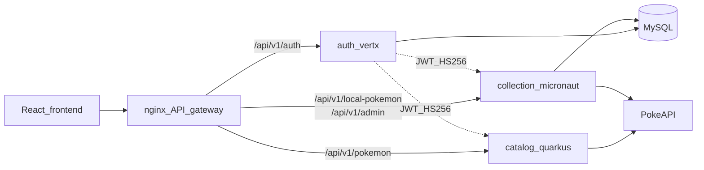

# Polyglot PokeApp: Vert.x + Quarkus + Micronaut

## Por qué este diseño encaja con el JD

El aviso pide *“Quarkus, Vert.x, Micronaut, **or** Kotlin”* (alternativa, no los tres). También pide *seleccionar tecnologías*, *POCs* y *transición a producción*. Un monolito con los tres frameworks juntos sería un anti-patrón; un **POC polyglot** con un servicio por stack demuestra exactamente ese juicio técnico.

**Spring Boot se elimina** del runtime. No se mantiene “Spring + Quarkus” en el mismo proceso.

## Arquitectura objetivo



| Servicio             | Stack                          | Responsabilidad (API actual)                                           | Por qué este stack                                                                 |
| -------------------- | ------------------------------ | ---------------------------------------------------------------------- | ---------------------------------------------------------------------------------- |
| `auth-service`       | **Vert.x** (Java 21)           | `POST /api/v1/auth/register`, `POST /api/v1/auth/login`; tabla `users` | Event-loop + JWT/BCrypt a mano: muestra Vert.x “puro”                              |
| `catalog-service`    | **Quarkus** + Vert.x WebClient | `GET /api/v1/pokemon`, `GET /api/v1/pokemon/{idOrName}`                | Quarkus brilla en HTTP reactivo, cache y native/fast startup; Vert.x queda visible |
| `collection-service` | **Micronaut**                  | `/api/v1/local-pokemon/`** y `/api/v1/admin/sync-jobs/**`              | DI compile-time, JPA/Flyway, jobs de sync: contraste claro vs Quarkus              |

Contrato HTTP, códigos de error RFC 7807, JWT y roles (`USER`/`ADMIN`) se **preservan** para que [frontend/](frontend/) casi no cambie.

## Estructura del monorepo

```
services/
  auth-vertx/          # Vert.x Gradle module
  catalog-quarkus/     # Quarkus Gradle module
  collection-micronaut/# Micronaut Gradle module
shared/
  openapi/             # contratos OpenAPI por servicio (Swagger)
  jwt-contract.md      # claims, issuer, secret env vars
frontend/              # sin cambio de rutas (proxy vía nginx)
docker-compose.yml     # mysql + 3 backends + frontend/gateway
docs/POLYGLOT.md       # guía de entrevista: por qué cada stack
```

El monolito actual (`src/main/java/...`, `build.gradle` Spring) se **retira** tras migrar (o se deja un commit/tag `spring-monolith` como referencia de estudio).

## Reuso del Clean Architecture actual

Lo que **sí se porta** (casi sin Spring):

- [domain/](src/main/java/org/ballastlane/pokeapp/domain/) — modelos, reglas, excepciones
- [application/port + service](src/main/java/org/ballastlane/pokeapp/application/) — casos de uso
- Migraciones Flyway [V1/V2](src/main/resources/db/migration/) — ownership: `auth` aplica/valida `users`; `collection` aplica `pokemon*` (una sola app Flyway “owner” de schema en compose para no pelear migraciones: **collection** corre Flyway completo; auth solo lee/escribe `users`)

Lo que **se reescribe por stack**:

- Controllers / security / DI (`config`, `web`, Spring Security, Spring Data JPA, RestClient)
- Tests de slice/e2e por framework

## Decisiones concretas (sin opciones abiertas)

1. **Gateway:** nginx del frontend (ya existe [frontend/nginx.conf](frontend/nginx.conf)) enruta por prefijo a los tres servicios; el browser sigue hablando a `:3000` / Vite proxy.
2. **Auth JWT compartido:** mismo `POKEAPP_JWT_SECRET`, issuer `pokeapp`, claims actuales; cada servicio valida el Bearer (Vert.x handler / Quarkus SmallRye JWT o filtro manual / Micronaut Security JWT).
3. **DB:** un MySQL compartido (como hoy, puerto host 3307); no hay sincronización entre servicios más allá de JWT + tablas.
4. **Catalog público:** sin auth (igual que [SecurityConfig](src/main/java/org/ballastlane/pokeapp/config/SecurityConfig.java)); collection exige JWT; admin endpoints exigen `ADMIN`.
5. **Lenguaje:** Java 21 en los tres (Kotlin no, aunque el JD lo menciona como alternativa).
6. **OpenAPI:** cada servicio expone Swagger; nginx puede listar tres UIs o un índice en README.
7. **Docker Compose:** reemplaza el servicio `backend` único por `auth`, `catalog`, `collection`.

## Mapeo de migración por fases

### Fase 0 — Baseline

- Tag/branch del monolito Spring.
- Extraer checklist de endpoints y tests de aceptación (login, browse, sync, restock, edit).

### Fase 1 — `auth-vertx`

- Vert.x `Router` + JDBC client (o Vert.x SQL client) sobre `users`.
- Register/login + emisión JWT HS256 compatible.
- Tests: Vert.x JUnit 5 / WebClient.

### Fase 2 — `catalog-quarkus`

- Resources JAX-RS/RESTEasy; cliente PokeAPI con Vert.x WebClient; cache Caffeine/Quarkus Cache.
- Portar `BrowsePokemon` / `GetPokemonDetail`.
- Tests: Quarkus `@QuarkusTest` + WireMock.

### Fase 3 — `collection-micronaut`

- Controllers Micronaut; Hibernate/JPA o Micronaut Data; sync + bulk sync (virtual threads o executor).
- Portar `ManageLocalPokemon`, `SyncPokemon`, `BulkSyncPokemon`.
- Validar JWT + roles ADMIN en create/delete/sync-jobs.
- Tests: Micronaut Test + Testcontainers MySQL.

### Fase 4 — Gateway + Compose + frontend

- Actualizar nginx/`docker-compose.yml`.
- Ajustar proxy Vite (`/api` → gateway o rutas a servicios en dev).
- Smoke e2e: flujo completo con demo users `ash` / `admin`.

### Fase 5 — Limpieza y material de entrevista

- Eliminar módulo Spring.
- Actualizar [README.md](README.md) y escribir `docs/POLYGLOT.md` (tabla Spring vs Quarkus vs Micronaut vs Vert.x: startup, DI, reactive, native image, cuándo elegir cada uno).
- Actualizar skills de Clean Architecture si hace falta para multi-módulo.

## Riesgos a tener en cuenta

- **Contrato JWT idéntico** entre emisores/validadores; un claim distinto rompe el frontend.
- **Flyway:** una sola app debe poseer migraciones.
- **CORS:** solo en el gateway (o consistente en los tres).
- **Alcance:** es una reescritura grande (~80 clases Java + tests); el valor es el POC de entrevista, no “más features”.

## Criterio de éxito

- `docker compose up --build` levanta MySQL + 3 backends + frontend.
- Mismas URLs de usuario (`:3000`), mismos flujos US01–US04 y Restock Collection.
- Cero dependencia Spring en runtime.
- Documento corto listo para explicar en inglés C1 *por qué* cada servicio usa su stack.